# Hi, I'm Talha Çerçioğlu 👋

### Software Engineer | Team Lead

I'm a Computer Engineer focused on building software solutions, developing backend systems, and optimizing business processes.

Currently working on ERP & CRM solutions, API integrations, custom workflows, and software development.

- 🔭 Working on software solutions and business process automation
- 🌱 Exploring PHP, Symfony, Laravel, and cloud technologies
- 💻 Interested in Backend Development, APIs, and System Design
- 🤝 Open to collaboration and interesting projects
- 📫 **Contact:** [talhacercioglu@gmail.com](mailto:talhacercioglu@gmail.com)

---

### Connect with me

  
  
  
  

---

### Tech Stack

**Languages:** Python · PHP · C# · C · Go · Swift · Java · R

**Backend & Frameworks:** .NET · Flask · Symfony · Laravel

**Databases & Cloud:** MySQL · Firebase · AWS

**Data Science & AI:** TensorFlow · PyTorch · Keras · OpenCV · Scikit-learn · Pandas · NumPy · SciPy · Matplotlib · Plotly

**Tools:** Git · GitHub · MLflow · Anaconda

---

### GitHub Statistics

  

  

### Languages

  

